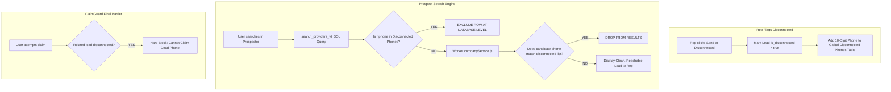

# Fix Plan: Disconnected Phone & Group Leak in Search

> **Status:** Implementation Plan  
> **Problem Reported:** `HUMAIR DME SOLUTION` (Enfield, CT) appeared in Prospect Search and when clicked to claim, ClaimGuard warned:  
> *"Looks related to ALPHA DME LLC (CHARLOTTE, NC), claimed by Rick Nelson, status disconnected · same phone"*  
> *"Looks related to BLUE DME (PISCATAWAY, NJ), claimed by Rick Nelson, status disconnected · same phone"*  
> **Core Question:** *If Rick Nelson already marked this phone number as disconnected, why is it showing up in search as a fresh lead?*

---

## 1. Root Cause Breakdown (Why It Happened)

The bug occurs because disconnection is currently tracked **only on individual lead NPI rows**, rather than treating a verified dead phone number as a **registry-wide dead circuit**.

```
   ┌─────────────────────────────────────────────────────────────┐
   │ 1. Rick Nelson claims ALPHA DME LLC & BLUE DME              │
   │    Phone: (860) 265-xxxx                                    │
   │    Rick calls -> Number is dead -> Clicks "Disconnected"    │
   │    Result: `leads` rows for those 2 NPIs have               │
   │            is_disconnected = true, status = 'disconnected'  │
   └──────────────────────────────┬──────────────────────────────┘
                                  │
                                  ▼
   ┌─────────────────────────────────────────────────────────────┐
   │ 2. HUMAIR DME SOLUTION exists in `npi_records`               │
   │    NPI: 1982245229 (different NPI!)                         │
   │    Phone: (860) 265-xxxx (EXACT SAME PHONE NUMBER!)         │
   └──────────────────────────────┬──────────────────────────────┘
                                  │
                                  ▼
   ┌─────────────────────────────────────────────────────────────┐
   │ 3. Ben searches in Prospector                               │
   │    - `search_providers_v2()` queries `npi_records`          │
   │      -> DOES NOT check if `r.phone` is disconnected!        │
   │    - `companyService.js` checks `getClaimedNpisAmongSafe()` │
   │      -> Only checks candidate NPIs, NOT phone numbers!      │
   │    - `owned_group_npis()` checks identity groups            │
   │      -> EXPLICITLY ignores leads with `is_disconnected=true`│
   │         (sql/010 line 363: "and not l.is_disconnected")     │
   │    RESULT: HUMAIR DME passes search filters and displays!   │
   └──────────────────────────────┬──────────────────────────────┘
                                  │
                                  ▼
   ┌─────────────────────────────────────────────────────────────┐
   │ 4. Ben clicks "Claim"                                       │
   │    - `claimguard.js` runs `/leads/related-check`            │
   │    - It compares phones in memory and sees Rick's leads!    │
   │    - It says: "Looks related to ALPHA DME, status           │
   │      disconnected · same phone"                             │
   │    RESULT: The user is shown a dead lead they should NEVER  │
   │            have seen in search in the first place!          │
   └─────────────────────────────────────────────────────────────┘
```

### The 4 Exact Code Flaws:

1. **`sql/010_group_aware_claim.sql` Line 363 (`owned_group_npis`):**
   ```sql
   select 1 from public.leads l
    where l.group_id = c.group_id
      and not l.is_disconnected     -- <--- BUG!
      and l.claimed_by is not null
   ```
   If a lead in the group was marked disconnected, the query ignores it and assumes the group is free to claim!
2. **`sql/024_remove_scoring.sql` (`provider_filter_sql` / `search_providers_v2`):**
   The SQL search query filters by state, taxonomy, name exclusions, etc., but **never excludes phone numbers that are marked disconnected in `public.leads`**.
3. **`worker/src/services/companyService.js` (Search Post-Filtering):**
   The worker filters out `claimedThisRound` (by NPI) and `ownedThisRound` (by group). It **never checks if `provider.phone` is a known disconnected phone**.
4. **`docs/claimguard.js` / `worker/src/repos/relatedClaimsRepo.js`:**
   ClaimGuard knows the related lead is disconnected, but treats it merely as a soft warning modal with a "Claim anyway" button, instead of dropping it or hard-blocking the claim.

---

## 2. The Comprehensive Fix Architecture

We will implement a 4-tier defense so no rep ever wastes time seeing or claiming a known dead number:



---

## 3. Step-by-Step Implementation

### Step 1: Database View & Fast Index (`sql/042_disconnected_phone_exclusion.sql`)

Create an indexed table or materialized lookup of all 10-digit phone numbers associated with disconnected leads:

```sql
-- 042_disconnected_phone_exclusion.sql
begin;

-- Fast index on 10-digit phone key in public.leads
create index if not exists idx_leads_disconnected_phones
  on public.leads (public.identity_phone_key(phone, null))
  where (is_disconnected = true or status = 'disconnected');

-- Function to check if a phone is dead
create or replace function public.is_phone_disconnected(p_phone text)
returns boolean
language sql stable
as $$
  select exists (
    select 1 from public.leads l
     where (l.is_disconnected = true or l.status = 'disconnected')
       and l.phone is not null
       and public.identity_phone_key(l.phone, null) = public.identity_phone_key(p_phone, null)
       and length(public.identity_phone_key(p_phone, null)) = 10
  );
$$;

commit;
```

### Step 2: Integrate Disconnected Phone Filter into `search_providers_v2()`

In `sql/024_remove_scoring.sql` (or via `sql/042` patch), add the phone exclusion clause to `public.provider_filter_sql()`:

```sql
-- Exclude any provider whose phone is in the disconnected registry
v_where := array_append(v_where, $filter$
  not exists (
    select 1 from public.leads dl
     where (dl.is_disconnected = true or dl.status = 'disconnected')
       and dl.phone is not null
       and length(public.identity_phone_key(dl.phone, null)) = 10
       and public.identity_phone_key(dl.phone, null) = public.identity_phone_key(r.phone, null)
  )
$filter$);
```

**Result:** `HUMAIR DME SOLUTION` will be **filtered out directly by PostgreSQL** and will never be returned in search results.

### Step 3: Worker-Level Safety Net (`worker/src/services/companyService.js`)

In `companyService.js`, add a phone deduplication check alongside `getClaimedNpisAmongSafe`:

```javascript
// worker/src/services/companyService.js
const candidatePhones = pageResults
  .flatMap(pr => pr.result?.results || [])
  .map(p => p.phone)
  .filter(Boolean);

const disconnectedPhones = await leadsRepo.getDisconnectedPhonesAmong(supabase, candidatePhones);

// Filter out providers with dead phones:
for (const provider of results) {
  const phoneKey = clean10DigitPhone(provider.phone);
  if (phoneKey && disconnectedPhones.has(phoneKey)) {
    excludedAsDisconnected++;
    continue; // Drop completely
  }
  // proceed to accepted list
}
```

### Step 4: Sibling Branch Propagation (`worker/src/repos/leadsRepo.js`)

When a lead is moved to disconnected in `moveClaimedLeadsToDisconnected`:
- Query all other leads in `public.leads` that share the same `group_id` or the same 10-digit phone.
- Mark them all as `is_disconnected = true, status = 'disconnected'`.
- This ensures that if Rick marks `ALPHA DME` disconnected, `BLUE DME` and any other sibling branches are immediately marked disconnected in the database.

### Step 5: ClaimGuard Hard Blocking (`docs/claimguard.js`)

If an edge case somehow slips past search:
- In `claimguard.js`, if `related.some(r => r.status === 'disconnected' && r.why.includes('same phone'))`:
  - Disable the "Claim anyway" button.
  - Display a red alert banner:  
    `🚫 Cannot claim: Phone number (XXX) XXX-XXXX was verified disconnected by Rick Nelson on ALPHA DME LLC.`

---

## 4. Verification & Testing

| Step | Action | Expected Result |
| :--- | :--- | :--- |
| **Test 1** | Search for `HUMAIR DME SOLUTION` or zip `06082` | `HUMAIR DME SOLUTION` is **NOT returned** in search results. |
| **Test 2** | Search by phone number `860265xxxx` | 0 results returned (suppressed due to disconnected status). |
| **Test 3** | Rep marks a new lead as Disconnected | Sibling locations sharing that phone are immediately disconnected and excluded from future searches. |
| **Test 4** | Automated Worker test (`worker/test/searchFlow.test.js`) | Test verifies that providers with disconnected phones are filtered out during search. |
