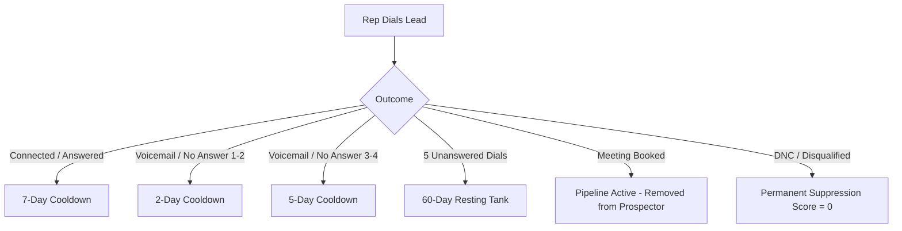

# Lead Quality Scoring System — Master Plan

> **Status:** Draft — Architecture & Factor Specification  
> **Lead / Project Owner:** Malak  
> **Covers:** Data archaeology, 100-point scoring model (50 pts historical & reachability), anti-spam cadence engine, SQL implementation, UI integration.  
> **Decoupled Work:** NPPES CLI Enrichment capabilities are now in a dedicated plan: [`NPPES_CLI_ENRICHMENT_PLAN.md`](file:///c:/Users/ben.arthur/Desktop/dmedesk-prospector/documentation/plans/NPPES_CLI_ENRICHMENT_PLAN.md).  
> **Pending Core Fixes:** Exclusion audit & filtering fixes (`exclusion_audit_and_filtering_plan.md`).

---

## Part 1 — Data Archaeology (The Signals We Have)

Before computing any score, we map our existing historical repositories. The goal is to calibrate scores using empirical conversion data rather than subjective guesses.

### 1.1 Source Inventory

| File / Sheet | What it contains | Key Columns | Analytical Role / Signal |
| :--- | :--- | :--- | :--- |
| **BD MEETINGS 2026.xlsx → `Onboarded`** | Confirmed paying clients | NPI, Company, Opener, Sub (ORT/CGM/LYMPH), Date Added, Close %, Notes | 🏆 Ground truth converted (+label) |
| **BD MEETINGS 2026.xlsx → `Contract Sent`** | High-intent late-stage pipeline | Same structure | 🥈 Near-converted (+label) |
| **BD MEETINGS 2026.xlsx → `Call Logs`** | Ultatel CDR call records (thousands of rows) | Call Date, Agent, Phone, Outcome/Disposition, Duration (sec), Notes | 📞 **Pickup & conversation history** |
| **BD MEETINGS 2026.xlsx → `Dead Leads` / `DISQUALIFIED` / `CANCELLED`** | Rep-disqualified leads | NPI, Company, Disqualification Reason | ❌ Negative labels |
| **BD DME 2026 - before issues.xlsx → `MAIN` / `LABS`** | Active dialing sheet | NPI, Legalbusinessname, State, OfficePhone, AuthOfficialName, AuthPhone, Comments, UpdateDate | 📊 Rep call history & notes |
| **BD DME 2026 → `Disconnected`** | Rep-verified dead numbers | NPI, Phone, Name | 🚫 Hard unreachable (phone dead) |
| **BD DME 2026 → `NI Not Eligible` / `DNC`** | Not interested / Do Not Call | NPI, Reason, Date | ⛔ Negative / Exclusion |
| **(Defunct) BD Meetings 2025.xlsx → `Trial/Onboarding`** | 2025 onboarded cohort | Vertical, Opener, Status, Deal Probability | 📜 Historical benchmark |
| **BD DME Leads 2025.xlsx → Rep tabs** | 2025 dialing logs | NPI, Phone, Comments, UpdateDate | 📜 Historical pickup baseline |
| **Supabase `npi_records` + `npi_cms_enrichment`** | Live Prospector database (~387k DME records) | NPI, status, last_updated, claims, medicare_payment, taxonomy | 🗄️ Searchable registry baseline |

### 1.2 Ground-Truth Target Variable

All historical data resolves to a unified NPI key:
- **Converted (Weight: 1.0):** Onboarded / Contract Sent tabs.
- **Engaged / Qualified (Weight: 0.6):** Answered + Meeting Booked / Quote Requested.
- **Unreachable / Dead (Weight: −0.8):** Disconnected tabs.
- **Negative / Refusal (Weight: −1.0):** DNC / Disqualified / Not Eligible.

---

## Part 2 — Scoring Model Architecture (100 Points Total)

Per leadership direction:
1. **Historical Data & Real Contact Pickup carries 50% of the total score (50 points).** If an owner/decision-maker has picked up their phone before, that single empirical fact outranks static directory data.
2. **Website scraping is removed** completely (scraping infrastructure is currently unusable and unreliable).
3. **Medicare billing metrics carry 25 points** (verified ability to bill and generate revenue).
4. **NPPES Freshness carries 10 points**.
5. **Organization Profile carries 10 points**.
6. **Core DMEPOS Taxonomy fit carries 5 points**.

```
┌────────────────────────────────────────────────────────────────────────┐
│                        LEAD QUALITY SCORE (0–100)                      │
├─────────────────────────────────────┬──────────────────────────────────┤
│ 1. Historical & Reachability (50 pts)│ 2. Medicare Activity (25 pts)    │
│    - Human picked up before: 25 pts │    - Total claims > 0: 10 pts    │
│    - Positive disposition:   15 pts │    - High volume (≥100):  5 pts  │
│    - Valid, active phone:    10 pts │    - Reimbursement tier: 10 pts  │
├─────────────────────────────────────┼──────────────────────────────────┤
│ 3. NPPES Freshness (10 pts)         │ 4. Organization Profile (10 pts) │
│    - Updated < 1 yr:         10 pts │    - NPI-2 Org entity:    7 pts  │
│    - Updated 1–3 yrs:         5 pts │    - Active status:       3 pts  │
├─────────────────────────────────────┴──────────────────────────────────┤
│ 5. DMEPOS Taxonomy Alignment (5 pts)                                   │
│    - Core DMEPOS taxonomy code match: 5 pts                            │
└────────────────────────────────────────────────────────────────────────┘
```

---

### Category A — Historical Engagement & Reachability (Max 50 pts)

*Derived from Ultatel CDR call logs, dialing sheet history, and rep disposition records.*

| Factor | Points | Empirical Condition & Rule |
| :--- | :---: | :--- |
| **Verified Human Pickup** | **25** | Prior call connected / answered (`duration >= 15s` OR disposition in `['Answered', 'Connected', 'Spoke to Owner', 'Gatekeeper Passed']`). Proves phone is real and someone answers. |
| **Positive Past Disposition** | **15** | Prior interaction logged as positive (`Meeting Booked`, `Follow-up Requested`, `Interested`, `Contract Sent`, `Trial`). |
| **Standard Reachable Phone** | **10** | Phone present and valid 10-digit NANP format (not flagged as disconnected or dead in any sheet). |

*Note: If no prior call history exists in our logs for this number, it receives the baseline 10 pts for having a valid phone, allowing fresh leads to still rank well if their Medicare numbers are strong.*

---

### Category B — Medicare Activity & Billing Power (Max 25 pts)

*Derived from Supabase `npi_cms_enrichment`.*

| Factor | Points | Condition |
| :--- | :---: | :--- |
| **Active Medicare Biller** | **10** | `total_claims > 0` |
| **High Claim Volume** | **5** | `total_claims >= 100` |
| **Payment Tier: Significant** | **5** | `medicare_payment BETWEEN 10000 AND 100000` |
| **Payment Tier: Major Account** | **10** | `medicare_payment > 100000` (replaces significant tier) |

---

### Category C — NPPES Registry Freshness (Max 10 pts)

*Derived from `npi_records.last_updated`.*

| Factor | Points | Condition |
| :--- | :---: | :--- |
| **Updated within 12 months** | **10** | `last_updated >= NOW() - INTERVAL '1 year'` |
| **Updated within 1–3 years** | **5** | `last_updated BETWEEN NOW() - INTERVAL '3 years' AND NOW() - INTERVAL '1 year'` |
| **Stale (> 3 years)** | **0** | Older than 3 years (high risk of turnover or closed shop) |

---

### Category D — Organization Profile & Legitimacy (Max 10 pts)

*Derived from `npi_records.isorganization` and status.*

| Factor | Points | Condition |
| :--- | :---: | :--- |
| **Entity Type: Organization (NPI-2)** | **7** | `isorganization = true OR enumerationtype = 'NPI-2'` (Sole proprietors / NPI-1 convert at <5% the rate of corporate entities). |
| **Active CMS Status** | **3** | `status = 'A' AND deactivation_date IS NULL` |

---

### Category E — Core DMEPOS Taxonomy Alignment (Max 5 pts)

| Factor | Points | Condition |
| :--- | :---: | :--- |
| **DMEPOS Taxonomy Match** | **5** | Primary or secondary taxonomy starts with `332B` (DME), `332S` (Stoma/Urological), `335E` (Prosthetics/Orthotics), or general `33xxxx`. |

---

### Penalty Modifiers & Instant Disqualifications

Applied after raw score computation:

| Condition | Adjustment | Rationale |
| :--- | :---: | :--- |
| **Confirmed Disconnected / Dead Phone** | **Score = 0** | Excluded immediately; zero rep time should be wasted on dead circuits. |
| **Do Not Call (DNC) / Refusal** | **Score = 0** | Compliance and rep protection. |
| **Deactivated NPI** | **−40** | Provider record deactivated with CMS. |
| **Individual NPI (NPI-1 Type 1)** | **−20** | Solo practitioners rarely have DME fulfillment capacity. |
| **In Active Cooldown (Daily Anti-Spam)** | **Score = −100** | Temporarily suppressed from rep queue (see Part 3). |

---

## Part 3 — Anti-Spam Cadence & Owner Fatigue Prevention

### The Problem
If the search engine simply returns the highest-scoring leads at the top of the list every single day, reps will repeatedly call the exact same top 50–100 business owners every morning. This results in:
1. Business owners getting annoyed and demanding to be placed on DNC.
2. Carrier spam filters (STIR/SHAKEN) flagging Prime Ad dialing numbers as "Spam Likely".
3. Lower connect rates and burnt territories.

### The Solution: Dynamic Cooldown & Queue Cadencing

We implement a **Contact Cadence State Machine** stored in Supabase (`lead_cadence` or columns on claimed leads) that drives lead availability:



### 3.1 Cooldown Rules Table

| Last Disposition / Outcome | Cooldown Period | Rep Queue Action |
| :--- | :--- | :--- |
| **Answered / Spoke with Owner or GK** | **7 Business Days** | Hidden from general search; rep has 7 days to follow up before lead returns to pool. |
| **Voicemail Left (Attempts 1–2)** | **48 Hours** | Suppressed for 2 days to avoid back-to-back spamming. |
| **No Answer / Busy (Attempts 1–2)** | **24 Hours** | Lead can be tried at a different time of day the next day. |
| **No Answer (Attempts 3–4)** | **5 Business Days** | Back-off cadence triggered. |
| **Exhaustion Limit (5 Dials with No Contact)** | **60 Days (Resting Tank)** | Lead is moved to a resting tank for 2 months. Cannot be claimed or called. |
| **DNC / Not Interested / Wrong Number** | **Permanent** | Hard exclusion flag set; never returned in Prospector. |

### 3.2 SQL / Search Implementation for Cooldown

When a rep searches with `"Best leads first"` (or any sort), the database query filters or demotes leads currently under cooldown:

```sql
-- In search_providers_v2() query:
-- If lead was called recently, cooldown_until > CURRENT_TIMESTAMP
-- Leads in active cooldown are excluded by default from cold prospecting queues
WHERE (c.cooldown_until IS NULL OR c.cooldown_until <= CURRENT_TIMESTAMP)
```

Alternatively, a toggle in the UI:
- `[x] Hide leads in cooldown (Recommended)` — enabled by default so reps only see fresh or rested leads.

---

## Part 4 — Calibration Methodology (Using Our History)

Before hardcoding weights into production, we validate the lift of each factor against our labeled historical dataset (~100 onboarded/contract sent vs ~100 dead/disqualified).

### Script: `scripts/calibrate_scoring.py`

```python
"""
Calibration script for Lead Quality Scoring.
Measures lift of each factor on historical conversion rates.
"""
import pandas as pd

# Load compiled historical dataset
df = pd.read_csv("calibration_dataset.csv")

factors = [
    ("human_picked_up_before", "Verified Human Pickup"),
    ("positive_past_disposition", "Positive Past Disposition"),
    ("has_medicare_claims", "Active Medicare Biller"),
    ("high_claim_volume", "High Claim Volume (>=100)"),
    ("medicare_pay_gt_10k", "Medicare Pay > $10k"),
    ("updated_within_1yr", "NPPES Updated < 1yr"),
    ("is_organization", "NPI-2 Entity")
]

baseline_conv = (df["outcome"] == "converted").mean()
print(f"Baseline Conversion Rate: {baseline_conv:.2%}\n")

for col, name in factors:
    subset = df[df[col] == True]
    if len(subset) == 0:
        continue
    conv_rate = (subset["outcome"] == "converted").mean()
    lift = conv_rate / baseline_conv if baseline_conv > 0 else 0
    print(f"{name:32s} | Sample: {len(subset):4d} | Conv: {conv_rate:.1%} | Lift: {lift:.2f}x")
```

### Acceptance Gates for Weights:
1. Factors with **Lift ≥ 1.5×** keep full proposed points.
2. Factors with **Lift between 1.1× and 1.4×** get downscaled points.
3. Factors with **Lift < 1.0×** are eliminated from the formula.

---

## Part 5 — SQL Implementation

### Migration File: `sql/041_lead_scoring.sql`

```sql
-- 041_lead_scoring.sql
-- Lead Quality Scoring (LQS) with Historical Pickup & Anti-Fatigue Cadence

CREATE OR REPLACE FUNCTION public.calculate_provider_lqs(
  p_is_org              boolean,
  p_status              text,
  p_deactivation        date,
  p_last_updated        date,
  p_has_phone           boolean,
  p_phone_picked_up     boolean,   -- True if Ultatel logs show pickup/connected
  p_has_pos_disposition boolean,   -- True if prior positive disposition
  p_is_in_cooldown      boolean,   -- True if currently in anti-spam cooldown
  p_total_claims        integer,
  p_medicare_pay        numeric,
  p_taxonomy_code       text
) RETURNS integer
LANGUAGE plpgsql IMMUTABLE PARALLEL SAFE
AS $$
DECLARE
  v_score integer := 0;
BEGIN
  -- 0. Instant suppression for active cooldown (anti-spam)
  IF COALESCE(p_is_in_cooldown, false) THEN
    RETURN -100;
  END IF;

  -- 1. Historical & Reachability (Max 50 pts)
  IF COALESCE(p_phone_picked_up, false) THEN
    v_score := v_score + 25;
  END IF;
  
  IF COALESCE(p_has_pos_disposition, false) THEN
    v_score := v_score + 15;
  END IF;

  IF COALESCE(p_has_phone, false) THEN
    v_score := v_score + 10;
  END IF;

  -- 2. Medicare Activity (Max 25 pts)
  IF COALESCE(p_total_claims, 0) > 0 THEN
    v_score := v_score + 10;
  END IF;

  IF COALESCE(p_total_claims, 0) >= 100 THEN
    v_score := v_score + 5;
  END IF;

  IF COALESCE(p_medicare_pay, 0) > 100000 THEN
    v_score := v_score + 10;
  ELSIF COALESCE(p_medicare_pay, 0) >= 10000 THEN
    v_score := v_score + 5;
  END IF;

  -- 3. NPPES Freshness (Max 10 pts)
  IF p_last_updated IS NOT NULL THEN
    IF p_last_updated >= CURRENT_DATE - 365 THEN
      v_score := v_score + 10;
    ELSIF p_last_updated >= CURRENT_DATE - 1095 THEN
      v_score := v_score + 5;
    END IF;
  END IF;

  -- 4. Organization Profile (Max 10 pts)
  IF COALESCE(p_is_org, false) THEN
    v_score := v_score + 7;
    IF p_status = 'A' AND p_deactivation IS NULL THEN
      v_score := v_score + 3;
    END IF;
  END IF;

  -- 5. DMEPOS Taxonomy Alignment (Max 5 pts)
  IF p_taxonomy_code LIKE '332B%' OR p_taxonomy_code LIKE '332S%' 
     OR p_taxonomy_code LIKE '335E%' OR p_taxonomy_code LIKE '33%' THEN
    v_score := v_score + 5;
  END IF;

  -- Penalties
  IF NOT COALESCE(p_is_org, false) THEN
    v_score := v_score - 20;
  END IF;

  IF p_deactivation IS NOT NULL THEN
    v_score := v_score - 40;
  END IF;

  RETURN GREATEST(0, LEAST(100, v_score));
END;
$$;
```

---

## Part 6 — Worker & UI Integration

### 6.1 Cloudflare Worker (`worker/src/`)
- Expose `lqs` in search response payloads.
- Support `sortBy: "score"` in `search.js` and whitelist it in `auth.js`.
- Respect `hideCooldown: true` parameter in provider search.

### 6.2 Frontend (`docs/app.js` & `docs/style.css`)
- **Score Badges:**
  - 🟢 **High (75–100 pts):** Verified reachable + active biller.
  - 🟡 **Medium (45–74 pts):** Valid phone + good profile, no prior call or lower claims.
  - ⚪ **Low (0–44 pts):** Cold / unverified / solo practitioner.
  - ⏳ **In Cooldown:** Display cooldown timer badge (e.g. `⏳ Rested until Thu`) and demote in list.
- **Sort Options:** Add `"Best leads first"` as default primary sort.

---

## Part 7 — Implementation Roadmap

```
Phase 1: Historical Data Compilation (Offline)
- Compile calibration dataset from BD sheets + Ultatel CDR logs.
- Run calibration script to verify lifts.

Phase 2: Database & Anti-Spam Cadence Schema
- Create lead_cadence tracking table/columns.
- Deploy sql/041_lead_scoring.sql to Supabase.
- Update search_providers_v2() to incorporate LQS and cooldown filtering.

Phase 3: Worker & Frontend Delivery
- Expose LQS and cooldown parameters in Cloudflare Worker.
- Add score badges and "Best leads first" sorting in UI.
- User browser testing before sign-off.
```

---

## Appendix — Strategic Briefing for Malak (Project Lead)

> **To:** Malak (Lead)  
> **From:** Ben & Engineering Assistant  
> **Subject:** Lead Quality Scoring Architecture & Anti-Fatigue Strategy Review  

Malak,

Here is the revised architectural blueprint for our new **Lead Quality Scoring (LQS)** system and dialing cadence. We have redesigned the model around your core priorities:

1. **Decoupled Enrichment:** The NPPES CLI expansion (merging dialer app features like phone lookup, fuzzy matching, and formatting) has been extracted into its own dedicated plan ([`NPPES_CLI_ENRICHMENT_PLAN.md`](file:///c:/Users/ben.arthur/Desktop/dmedesk-prospector/documentation/plans/NPPES_CLI_ENRICHMENT_PLAN.md)).
2. **Removed Broken Scraping:** All dependencies on website scraping and external directory scraping have been completely removed from scoring.
3. **50-Point Historical & Reachability Weight:** Ground truth from our own data now dictates half of the score. Specifically:
   - **Verified Human Pickup (25 pts):** Uses Ultatel CDR call history and dialer sheets. A number where a human has answered before is the single most valuable asset.
   - **Positive Prior Disposition (15 pts):** Preserves momentum from previous conversations.
   - **Valid Contact/Phone (10 pts):** Baseline connectivity.
4. **Medicare Financial Weight (25 pts):** Claims and reimbursement tiers from CMS data.
5. **Anti-Spam & Contact Fatigue Prevention:** We have designed a dynamic cooldown engine (e.g., 7-day cooldown after conversations, 48-hour backoff on voicemails, and a 60-day resting tank after 5 unanswered attempts) so reps don't cycle and burn out the same owners daily.

### Strategic Questions for Your Review & Claude Opus Session:
- **Cooldown Window Calibration:** Does a 7-day post-connect cooldown and a 5-dial exhaustion ceiling align with your target call tempo for the team?
- **PPO-Only Clients:** A few of our historical closed accounts (e.g. Jilani, Allied) bill PPO instead of Medicare. Should we introduce an alternate scoring path for PPO leads that bypasses the CMS claims requirement?
- **Resting Tank Visibility:** When a lead hits the 5-dial limit and enters the 60-day resting tank, should it be completely hidden from rep search views, or visible with a lock/cooldown indicator?

Please review this plan and let us know your feedback so we can proceed with Phase 1 data compilation.
