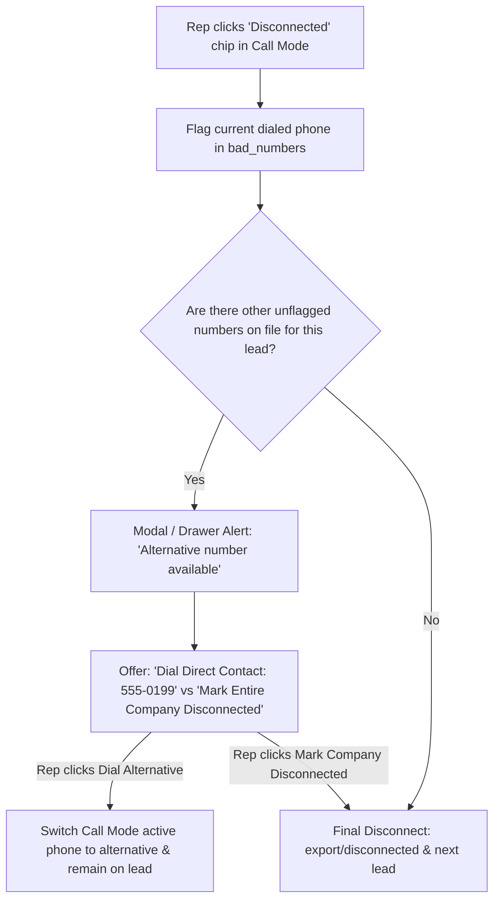
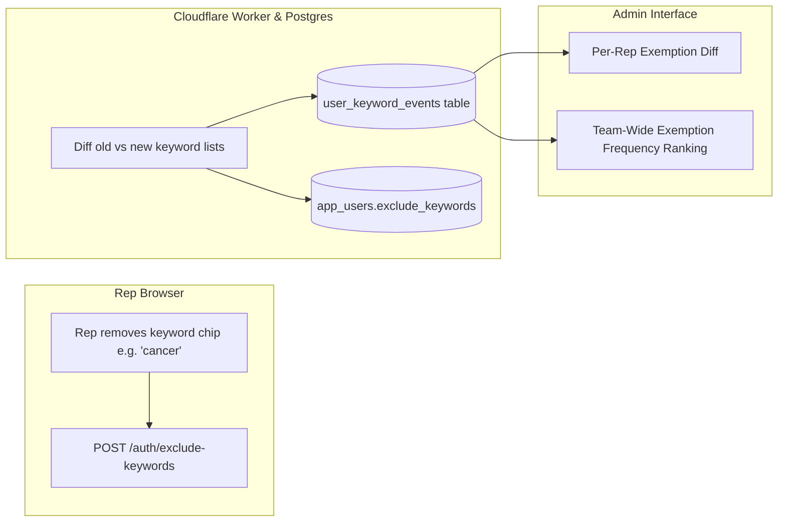

# Architectural Plan: Unified Call-Mode Disconnected Flow & Keyword Exemption Tracking

**Document Status:** Ready for Review (Malak)  
**Author:** Antigravity / Ben Arthur  
**Date:** October 15, 2026  
**Target Systems:** Call Mode (`docs/callmode.js`, `docs/app.js`), Worker API (`worker/src/index.js`, `worker/src/lib/auth.js`, `worker/src/repos/`), Database/Supabase (`sql/`), Admin UI  

---

## 1. Executive Summary

This plan defines the architectural and UX specifications for two core system improvements requested by the team:

1. **Unified Call-Mode "Disconnected" Flow:** Replaces the confusing dual-mechanism ("Not in service" inline under the phone number vs. "Disconnected" under outcome chips) with a single, intelligent **"Disconnected"** button that flags the bad number, automatically detects alternative numbers on file, prompts to dial the alternative number, or finalizes company-level disconnection if no other numbers exist.
2. **Keyword Exemption Tracking & Audit System (Hybrid Model):** Combines granular event logging (tracking every time a rep removes/exempts or adds a keyword) with an Admin-facing diff and analytics view (showing which reps have exempted which baseline keywords and team-wide exemption frequencies).

---

## 2. Part I: Unified Call-Mode "Disconnected" Workflow

### 2.1 The Current Flaw
Currently in [`docs/callmode.js`](file:///c:/Users/ben.arthur/Desktop/dmedesk-prospector/docs/callmode.js):
* **Inline links under phone numbers:** "Wrong number" and "Not in service" ([`callmode.js:L227`](file:///c:/Users/ben.arthur/Desktop/dmedesk-prospector/docs/callmode.js#L227)) mark only that individual phone in `bad_numbers`.
* **Bottom outcome chip:** "Disconnected" ([`callmode.js:L480`](file:///c:/Users/ben.arthur/Desktop/dmedesk-prospector/docs/callmode.js#L480)) triggers a native browser popup (`confirm("Send ... to Disconnected? It leaves Prospect for everyone and can't be undone.")`) and permanently removes the company from Prospect for the entire team.
* **Why this is problematic:**
  - Reps are confused about which one to click.
  - A rep might click "Disconnected" on the entire company after dialing one non-working number, even though the lead has a valid decision-maker direct phone or secondary office line.
  - Native browser popups create cognitive friction and interrupt dialing cadence.

### 2.2 The Unified Experience ("One Button, Intelligent Dial-Next")



### 2.3 Detailed Step-by-Step Logic

1. **Single Entry Point:**
   - Rep clicks the **`Disconnected`** button under "How did it go?".
   - The inline "Not in service" button under the phone number is retired (only a clean "Wrong number" flag remains if needed, or all phone failures funnel through the outcome).
2. **Automatic Number Flagging:**
   - The currently active phone number is immediately submitted to `/leads/bad-number` (`reason: "disconnected"`), ensuring this specific line is never dialed again.
3. **Alternative Number Inspection:**
   - The client inspects the lead's remaining contact numbers (decision-maker direct phones, secondary company numbers) that are not already flagged in `bad_numbers`.
4. **Conditional Branching:**
   - **Case A: Another number exists:**
     - Call Mode displays an in-drawer prompt (non-blocking, styled modal/card):
       > **Line flagged as disconnected.**  
       > We found another number on file: **Jane Doe (Direct) — (555) 012-3456**.  
       > `[ Call (555) 012-3456 Now ]` &nbsp;&nbsp; `[ Mark Entire Company Disconnected ]`
     - If the rep taps **Call Alternative**, Call Mode updates the active number, logs the attempt, and stays on the lead.
     - If the rep taps **Mark Entire Company Disconnected**, it proceeds to Final Disconnect.
   - **Case B: No other numbers exist (or all numbers are flagged):**
     - The company is automatically finalized: calls `POST /export/disconnected`, removes the lead from Prospect for the team, records the disposition, and advances seamlessly to the next queue item.

---

## 3. Part II: Keyword Exemption Tracking (Hybrid Model A + B)

### 3.1 The Problem
* The company provides a baseline list of ~47 exclusion keywords ([`exclude_keywords.txt`](file:///c:/Users/ben.arthur/Desktop/dmedesk-prospector/scripts/nppes_ingest/exclude_keywords.txt)) such as `cancer`, `salon`, `hospital`, `optum`, `oxygen`, etc.
* Reps can remove chips in the search filter (exempting keywords to find leads that would otherwise be excluded).
* Currently, changes silently overwrite `app_users.exclude_keywords` as a plain string. Management has no visibility into:
  - Which reps have removed which keywords.
  - Which keywords are being actively exempted across the sales floor.
  - When exemptions were made.

### 3.2 Solution Architecture: The Hybrid Model



### 3.3 Database Migration: `user_keyword_events` (SQL 045)

```sql
-- sql/045_keyword_exemption_audit.sql
create table if not exists public.user_keyword_events (
  id uuid primary key default gen_random_uuid(),
  user_id uuid not null references public.app_users(id) on delete cascade,
  keyword text not null,
  action text not null check (action in ('exempted', 'added', 'cleared_all', 'restored_default')),
  created_at timestamptz not null default now()
);

create index if not exists idx_keyword_events_user on public.user_keyword_events(user_id, created_at desc);
create index if not exists idx_keyword_events_keyword on public.user_keyword_events(keyword, action);
```

### 3.4 Worker Backend Logic (`worker/src/lib/auth.js`)
When `POST /auth/exclude-keywords` is invoked:
1. Fetch the user's existing `exclude_keywords` string.
2. Split both old and new lists into normalized lowercase keyword sets.
3. Compute set differences:
   - `exempted = old_set - new_set` (terms the user removed)
   - `added = new_set - old_set` (terms the user added)
4. Batch-insert records into `user_keyword_events` with the current `session.id` and timestamp.
5. Update `app_users.exclude_keywords`.

### 3.5 Admin Dashboard Endpoints & UI

1. **Endpoint `GET /admin/keyword-exemptions`:**
   Returns:
   - **Baseline List:** The standard 47 company keywords.
   - **Per-User Active Diff:** For each user, list the keywords from the baseline that they are currently **exempting** (omitting), plus any custom keywords they added.
   - **Global Frequency Table:** Ranked list of which baseline keywords are most frequently exempted by reps (e.g. `cancer`: 9 reps, `oxygen`: 6 reps, `dentist`: 1 rep).
2. **Admin UI Component in `docs/index.html` (under Admin tab):**
   - **Exemption Heatmap / Table:** Quick scan to see which reps have customized their filters away from team policy.
   - **Insights for Management:** If many reps are exempting a specific keyword (e.g. `cancer` or `oxygen`), leadership can evaluate whether the baseline exclusion was too strict and should be modified centrally.

---

## 4. Implementation Phasing & Checklist

| Phase | Component | Key Deliverables | Safety & Verification |
| :--- | :--- | :--- | :--- |
| **Phase 1** | **Database Schema** | `sql/045_keyword_exemption_audit.sql` table & indexes | Verified with non-destructive `if not exists` migration. |
| **Phase 2** | **Worker Keyword Auditing** | Update `setExcludeKeywords` in `worker/src/lib/auth.js` to compute diffs & log events | Unit tests in `worker/test/auth.test.js` validating event generation on add/remove. |
| **Phase 3** | **Admin Exemption Reporting** | Route `GET /admin/keyword-exemptions` and Admin panel view | Verification in admin dashboard with mock/test user profiles. |
| **Phase 4** | **Call Mode Disconnected Unification** | Refactor `docs/callmode.js` to single "Disconnected" click with alternative-number prompt | Rep tested in call drawer; ensures no premature lead deletion when secondary lines exist. |

---

## 5. Decision Items for Malak's Review

1. **Alternative Number Priority:** When prompting to dial an alternative number, should Call Mode prioritize:
   - (A) Decision Maker direct phone first, then company main line? *(Recommended)*
   - (B) Whichever phone number appears next in the record order?
2. **Baseline Keyword Source:** Should the baseline keywords for diffing be loaded from a system config table in Postgres, or continue referencing the version-controlled `exclude_keywords.txt`?
3. **Threshold Alerts:** Should the system flag an admin alert if a rep exempts more than $X$ (e.g. 10) baseline keywords simultaneously?
