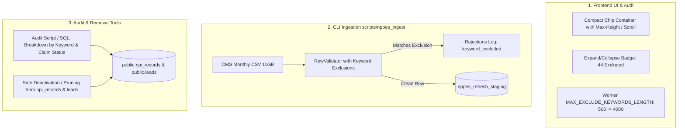

# Strategic Plan: Lead & NPI Exclusion Filtering, Audit, and UI Overhaul

## 1. Executive Summary & Problem Diagnosis

You have identified four distinct but tightly coupled problems when managing exclusion keywords (e.g., `hospital`, `clinic`, `pharmacy`, `oxygen`, `dentist`, `salon`, etc.):

| Problem Area | Current Limitation | Impact |
| :--- | :--- | :--- |
| **1. UI Sizing** | `.chip-input` uses unrestricted `flex-wrap: wrap` with no max-height or scroll container. | 40+ chips wrap into 8–10 lines of elements, visually dominating and bloating the Prospect search form. |
| **2. Character Cap** | Hardcoded `MAX_EXCLUDE_KEYWORDS_LENGTH = 500` in backend (`worker/src/lib/auth.js`). | 44 keywords with commas total ~550 characters, triggering HTTP 400 validation errors upon save. |
| **3. Database Contamination** | 387k+ existing rows in `public.npi_records` (and rows in `public.leads`) already contain these terms. | Unwanted leads appear in search queries, requiring repetitive filtering on every search. |
| **4. Ingestion Pipeline Leak** | `scripts/nppes_ingest` CLI only filters by State, Taxonomy, and Organization type (no keyword filter). | Every monthly CMS refresh re-ingests excluded providers back into `npi_records`. |

---

## 2. High-Impact Keyword Tradeoff Analysis (Important Notice)

Before applying deletions or ingestion blocks, review these specific keywords from your list:

> [!WARNING]
> **DME Domain Conflicts:**
> - **`oxygen`**: In the DME (Durable Medical Equipment) industry, Oxygen Concentrators, Portable Oxygen, and Liquid Oxygen are primary DME product lines. An exclusion on `oxygen` will drop legitimate DME oxygen suppliers (e.g., *"Precision Medical Oxygen & Mobility"*).
> - **`sleep`**: CPAP, BiPAP, and sleep apnea equipment are core DME categories. Excluding `sleep` will exclude home medical CPAP suppliers (e.g., *"Apex Sleep & Respiratory Services"*).
> - **`therapy`**: Many respiratory DME suppliers use "Respiratory Therapy Services" in their business name.
> - **`optum` / `lin care inc` / `walgreen co`**: These are large corporate entities; excluding them by exact phrase is safe and targeted.
> 
> **Recommendation:** We will structure the audit tool to report match counts for **each keyword independently** before any database removal, so you can review match samples for potentially sensitive terms like `oxygen` and `sleep`.

---

## 3. Detailed Solution Architecture



---

## 4. Phase 1: Frontend & Backend Limit Fixes

### 1.1 UI Box Visual Size Fix (`docs/style.css` & `docs/app.js`)
- **Container Sizing**:
  - Constrain `.chip-input` with `max-height: 92px` (approx. 2.5 rows of chips) and `overflow-y: auto`.
  - Add a styled slim scrollbar (`scrollbar-width: thin; scrollbar-color: var(--hairline-hover) transparent;`).
- **Compact Chip Presentation**:
  - Tighten chip padding (`2px 7px` vs current bloated tags) and font size (`12px`).
  - Add an inline counter badge and a "Clear all" link when chips > 0.
- **Collapsible Summary Mode (Optional Enhancement)**:
  - When the field loses focus, optionally collapse to a clean summary row: *"44 keywords active (click to view/edit)"* to keep the search form compact and distraction-free.

### 1.2 Character Limit Expansion (`worker/src/lib/auth.js` & `appscript/services/AuthService.js`)
- **Backend Change**:
  - In `worker/src/lib/auth.js`, raise:
    ```javascript
    // Before:
    const MAX_EXCLUDE_KEYWORDS_LENGTH = 500;
    // After:
    const MAX_EXCLUDE_KEYWORDS_LENGTH = 4000;
    ```
  - Note: Postgres column `app_users.exclude_keywords` is already defined as `text` (unbounded), so no SQL table migration is required for `app_users`.
  - Also update `appscript/services/AuthService.js` (if Google Sheets / Apps Script auth is still in use).
- **Session Token Overhead**:
  - A 4,000 character string in JWT results in a ~5.3 KB authorization header. This remains well within Cloudflare Worker / Vercel 8 KB–16 KB header limits.

---

## 5. Phase 2: CLI Ingestion Filtering (`scripts/nppes_ingest`)

To prevent excluded providers from re-entering the database on every monthly NPPES refresh, filtering must occur during raw CSV parsing before rows reach staging.

### 2.1 Code Changes
1. **`scripts/nppes_ingest/validate.py`**:
   - Add rejection constant:
     ```python
     REASON_KEYWORD_EXCLUDED = "keyword_excluded"
     ```
   - Update `RowValidator`:
     - Accept `exclude_keywords: tuple[str, ...] | None`.
     - In `check(provider)`:
       ```python
       if self.exclude_keywords and provider.name:
           name_lower = provider.name.lower()
           for term in self.exclude_keywords:
               if term in name_lower:
                   return Rejection(provider.source_row_number, provider.npi, REASON_KEYWORD_EXCLUDED, term)
       ```
2. **`scripts/nppes_ingest/cli.py` & `ingest.py`**:
   - Add CLI options to the `filters` argument group:
     - `--exclude-keywords`: Comma-separated exclusion strings.
     - `--exclude-keywords-file`: Path to a text file containing one exclusion phrase per line (defaulting to `scripts/nppes_ingest/exclude_keywords.txt`).
3. **Default Keyword File (`scripts/nppes_ingest/exclude_keywords.txt`)**:
   - Store the standard exclusion list in version control so that runs default to filtering out hospitals, clinics, dental, wigs, etc., automatically without needing a massive CLI command string.
4. **Rejections Reporting**:
   - The generated manifest (`scripts/out/<label>.manifest.json`) will report the exact count of rows rejected under `keyword_excluded`, ensuring complete visibility.

---

## 6. Phase 3: Systematic Database Audit & Removal

Because `npi_records` contains 387k+ rows and links with `public.leads`, `npi_cms_enrichment`, and identity grouping tables, removal must be deliberate and safe.

### 3.1 Step 1: Audit Script (`scripts/audit_exclusions.py` / SQL)
Create an audit utility that inspects the live database in read-only mode and outputs:
1. **Keyword-by-Keyword Hit Counts**:
   ```
   [AUDIT BREAKDOWN]
   Keyword: 'hospital'           -> 18,412 rows in npi_records
   Keyword: 'dentist'            ->  4,120 rows in npi_records
   Keyword: 'pharmacy'           -> 12,850 rows in npi_records
   Keyword: 'oxygen'             ->  1,215 rows in npi_records  <-- Check for DME!
   Keyword: 'sleep'              ->    890 rows in npi_records  <-- Check for DME!
   Keyword: 'salon'              ->    310 rows in npi_records
   ------------------------------------------------------------
   Total Unique Providers Matched: 46,290 / 387,400 (11.9%)
   ```
2. **Cross-Check with Leads**:
   - Matches currently claimed by team members in `public.leads`.
   - Matches with active call taps, buddy notes, or change alerts.
   - Matches that are unowned/unclaimed prospects.

### 3.2 Step 2: Removal & Cleanup Strategy

We have two options for the cleanup mechanism:

#### Option A: Status Soft-Deactivation (Recommended & Safest)
- Instead of hard-deleting rows (which could disrupt foreign keys or audit logs in `provider_field_history` / `identity_match_candidates`), we:
  - Set `status = 'X'` (or set `deactivation_date = CURRENT_DATE`) in `public.npi_records`.
  - `search_providers()` in SQL already excludes deactivated providers (`where r.deactivation_date is null and r.status = 'A'`), instantly hiding them from all prospecting and search results.
  - If unowned rows exist in `public.leads`, mark them as `is_disconnected = true` or archive them.
  - Claimed leads remain protected unless explicitly reviewed by an admin.

#### Option B: Batched Hard Purge
- Run a transactional batched deletion script:
  - Deletes from `npi_cms_enrichment` where NPI matches.
  - Deletes from `npi_records` where NPI matches **AND** NPI is not currently claimed in `public.leads`.
  - Batched in chunks of 1,000–5,000 rows with progress logging to prevent database locking and timeout issues.

---

## 7. Implementation Plan & Milestones

```
1. [Backend & Limits]
   - Update MAX_EXCLUDE_KEYWORDS_LENGTH in worker/src/lib/auth.js (and appscript).
   - Verify auth tests pass.

2. [Frontend UI Improvements]
   - Update docs/style.css: max-height, auto-scroll, compact chip styles.
   - Update docs/app.js: chip count badge, clear all action, clean layout.
   - Request user verification in browser (manual test).

3. [CLI Ingest Filtering]
   - Add scripts/nppes_ingest/exclude_keywords.txt.
   - Add REASON_KEYWORD_EXCLUDED and RowValidator check in scripts/nppes_ingest/validate.py.
   - Add CLI args (--exclude-keywords, --exclude-keywords-file) in cli.py.
   - Add unit test coverage in scripts/tests/test_validate.py.

4. [Audit & Removal Tooling]
   - Implement scripts/audit_exclusions.py (read-only audit reporting).
   - Review audit report with user (especially for terms like 'oxygen' and 'sleep').
   - Execute safe removal / deactivation on confirmed terms.
```
